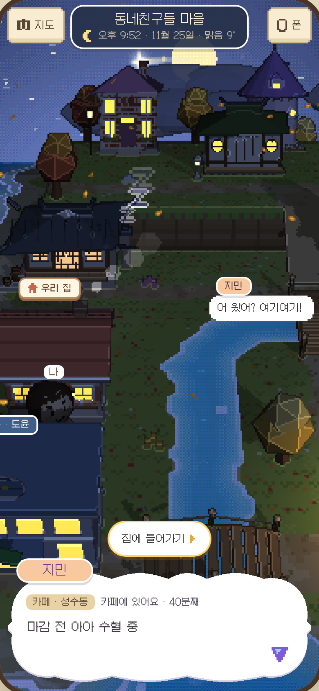
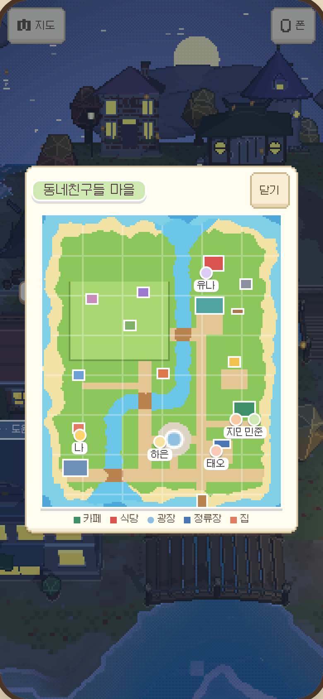
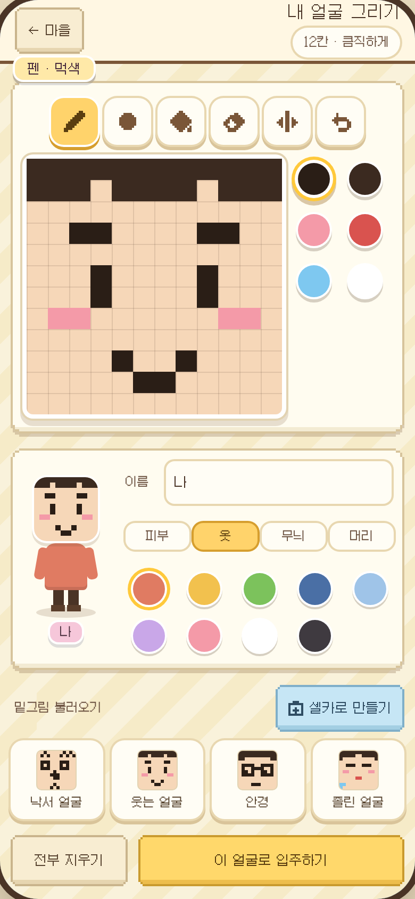
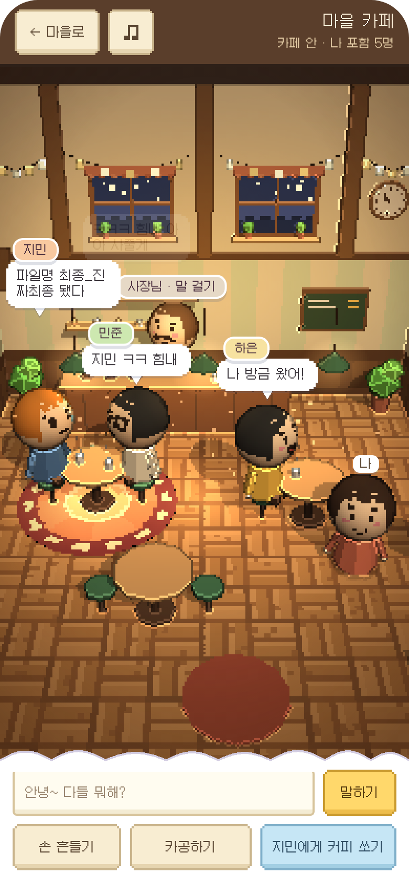
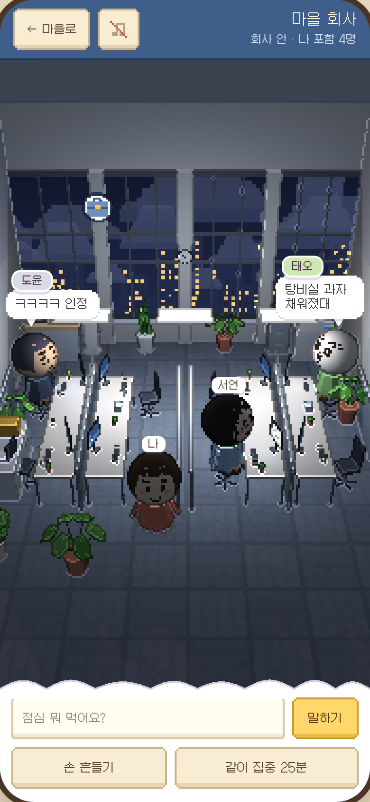

# 친구 마을 (Friend Village)

떨어져 사는 친구들이 지금 뭐 하고 있는지, 지도 대신 **동물의 숲 같은 도트 3D 마을**에서 보는 모바일 앱 프로토타입이에요.
_A mobile app prototype that shows what your friends are up to as residents of a pixel-art 3D village._

**▶ 라이브 데모: https://sooinjung.github.io/friend-village/**

| 마을 | 섬 지도 | 얼굴 그리기 | 카페 | 회사 |
|---|---|---|---|---|
|  |  |  |  |  |

## 왜 만들었나

회사와 도시가 달라진 친구들과 카톡만으로는 같이 있는 느낌이 잘 안 났어요. 동물의 숲 주민들처럼 각자 개성 있게 "살고 있는" 모습을 보면, 만나지 않아도 같이 있는 느낌이 들지 않을까 해서 시작했어요.

## 디자인 원칙

1. **같이 있는 느낌**: 친구가 어디서 뭘 하는지가 지도 핀이 아니라 마을 안의 장면으로 보여요.
2. **알아서 살아 있는 마을**: 시간, 날씨, 계절이 실제와 맞춰 바뀌고, 친구들이 말풍선으로 이야기해요.
3. **부담 없음**: GPS로 위치를 추적하지 않아요. 상태(집, 출근 중, 회사, 카페, 밥, 놀기)는 내가 직접 골라요. 배터리 부담도 없어요.

## 주요 기능

- 카톡방 하나 = 마을 하나. 방 정보로 마을 모양을 만들고, 같은 방이면 항상 같은 마을이 나와요.
- 실시간 시간·날씨·계절 반영 (밤에는 창문에 불이 켜지고, 노을과 별똥별이 보여요)
- 상태를 고르면 내 캐릭터가 그 장소까지 걸어가고, 카페·회사 안으로 들어갈 수 있어요
- 카페: 친구들과 말풍선 대화, 손 흔들기, 커피 쏘기
- 회사: "같이 집중 25분" 타이머
- 얼굴 그리기: 12칸/24칸 손그림, 사진을 픽셀 얼굴로 바꾸기
- 섬 지도, 마을 게시판(공지, 오늘의 단어 게임), 생일·공휴일 불꽃놀이

## 기술 구조

- **React 18 + Vite**, 3D는 **three.js (r149)** 로 그리고 픽셀 느낌은 저해상도 렌더링 + 외곽선 후처리로 냈어요.
- 원래 디자인 캔버스에서 화면별 프로토타입으로 만들었던 것을 일반 웹앱으로 옮겼어요.
  - `tools/dc2jsx.py`: 캔버스 화면 파일(템플릿 + 로직 클래스)을 React 화면(`view.jsx` + `logic.js` + `style.css`)으로 바꾸는 변환 스크립트
  - `src/dc/runtime.jsx`: 로직 클래스(state, `renderVals()`)를 React 컴포넌트로 감싸는 작은 런타임
- `src/screens/`: `Village`(마을, 앱의 중심), `Cafe`, `Office`, `FaceDraw`
- GitHub Actions로 기본 브랜치에 push하면 자동으로 빌드해서 GitHub Pages에 배포돼요.

## 만든 방식 (AI와 나의 역할)

> 초안이에요. 실제로 한 일에 맞게 고쳐 주세요.

- **내가 한 것**: 아이디어와 디자인 원칙, 화면별 기능 정의, UX 리서치 설계, 그리고 매번 실제 화면을 보고 문제를 짚어 수정 방향을 정한 것(예: 다리 길찾기 버그, 말풍선이 엉뚱한 곳에 뜨는 문제, 색 대비·터치 영역 같은 접근성 문제, 사진→픽셀 변환 품질).
- **AI(Claude)가 한 것**: 코드 작성. 제가 정한 기준대로 수정하고, 자동 화면 테스트(Playwright)로 결과를 확인했어요.

## 로컬에서 실행

```bash
npm install
npm run dev
```

## 크레딧

- 글꼴: [Galmuri](https://github.com/quiple/galmuri) (SIL Open Font License 1.1)
- 3D: [three.js](https://threejs.org/) (MIT License)
